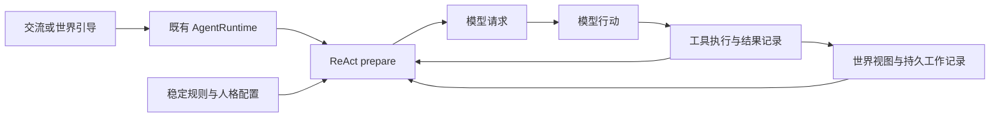

# 以 ctx 为中心的主动 bot 上下文设计

状态：设计讨论稿；每轮世界视图切片已实现，工作笔记与归档工具仍为规划。更新：2026-11-06。

bot 面对一个持续存在的世界，每次被唤起时读取当前状态，结合自己留下的目标、记录与实际行动结果，决定接下来做什么。稳定的世界规则和人格放在 system 提示中；本次唤起原因与 bot 可见的 ctx 视图通过 user 消息提供；运行中的模型行动和工具反馈保留 assistant/tool 关系。

这个方向将更多关注、解释和行动选择交给 bot。开发者提供可读、可写、可追溯的环境，允许 bot 用相对自由的笔记和工作方式组织自己的活动。完整工作记录与行为效果仍需实现验证；下文不改变已交付的 M4.W3 转交契约，W4 双路径与安装验收已完成。

## 核心思想

引导的作用是让 bot 获得一次重新观察和行动的机会。新事件可能值得立即处理，也可能只是补充环境信息；一次唤起也可以用于继续之前未完成的工作。是否行动、处理什么、是否需要对外回复，由 bot 根据世界规则、直接交流、已有目标和当前状态判断。

提示词组织以当前世界及工作记录为中心。开发者需要保证来源、身份、记录和执行结果可靠，但不必替每个事件预先写好行动分支，也不必把每段上下文都加工成固定的业务指令。

允许存在的自由度主要在于内容组织：bot 可以写笔记、修订计划、建立自己的分类、记录暂时不确定的判断。需要保持明确的是事实边界：谁提供了信息、它是什么时候的观察、动作是否实际执行、结果是否确定，以及什么记录会跨运行保留。

## 模型看到的消息

### 稳定的 system 提示

system 提示提供世界总规则、身份与人格，以及 bot 使用环境的基本约定。例如：世界中有哪些参与者，工具调用如何产生效果，如何理解 ctx 中的事件和工作记录，什么时候需要留下可接续的笔记。

这里的“稳定”表示其内容由配置或受信任的行为插件明确维护，不随每条外部事件重新改写。人格和世界规则可以修改，但应有明确的配置来源与生效边界。当前天气、新到消息和某次工具结果属于动态信息，不混入稳定规则。

### user 消息中的世界视图

user 消息承载本次观察材料。它可以包括唤起原因、直接交流、近期事件、当前环境，以及 bot 自己的工作记录。来源和内容性质应可识别，不能仅因传输 role 为 user 就把天气观察解释为人的请求。

下面是内容布局示意，不是已定义的数据 schema 或最终提示词模板：

```text
system
  世界规则与行动约定
  身份、人格与长期行为原则
  如何读取世界状态并留下工作记录

user
  本次唤起原因
    新事件 event-42 到达

  直接交流
    用户提出的要求及其身份

  当前环境
    当前时间、天气及观察时间

  近期事件
    event-42 的来源、时间与内容
    其他可见事件及归档引用

  我的工作记录
    当前目标、未完成事项、计划和笔记

  已有行动结果
    与当前事项相关的工具执行记录

assistant / tool
  本次运行中的行动及其反馈
```

这不是规定每次请求只能有两条消息。直接交流是否独立成条、历史对话如何排列，以及快照与本轮工具往返的具体位置，需要结合模型协议验证。工具请求与结果必须保留完整关联，不能用一段状态摘要替代尚未收束的调用链。

### 在推理边界刷新快照

每次推理前，根据当前状态重新构建业务视图。工具可能已经修改目标、产生新事实或写入笔记，下一轮推理应能够看到这些变化。模型调用开始后到达的信息留到下一推理边界接纳，不改写正在发送的请求。

完整 ctx 视图不应每轮追加到永久对话历史。当前视图属于本次请求材料；需要长期保留的是事件、工作记录、实际行动结果，以及明确选择保留的交流历史。这样同一条天气、计划或状态不会因为连续推理而被重复存成许多条历史输入。

## 整个 ctx 的含义

这里的“整个 ctx”指 bot 可见的业务世界。框架内部还存在配置、调度状态、消费位置、模型请求和临时执行值，直接递归序列化全部状态既会暴露无关实现细节，也可能把之前生成的提示词再次装入提示词。

建议由插件显式声明可供 bot 观察的状态范围及其呈现方式，装配负责组合。呈现应优先保持内容、来源和引用，少做开发者主观的语义筛选，让 bot 自己判断哪些内容值得关注。运行凭证不属于业务视图，模型输入本身也不作为下一轮的世界数据。

完整记录与一次请求的有限视图需要分开。当前 world 已经将普通事件归档到数据库，并在 ctx 中提供有界的近期文本；时间和天气有独立环境状态。未来可以直接利用这些呈现，再给 bot 提供读取归档原文的工具。现有 Python 查询方法并不等于模型已经拥有查询工具，这部分需要实际接线。

当内容超过窗口时，应让模型知道发生了省略，并保留可检索的身份。未完成事项不能仅因时间流逝就与近期事件一起消失，需要有独立的工作记录。记录保留、视图窗口和单次模型输入预算各有职责，不应以删除事实记录来解决提示词过长。

## 让 bot 能接续自己的工作

bot 上一次“做了什么”和“准备做什么”需要分别保存。

| 记录内容 | 主要写入者 | 对后续判断的意义 |
| --- | --- | --- |
| 世界事件与环境观察 | 来源插件及 world | 外部发生了什么，信息来自哪里 |
| 直接交流 | 交流入口 | 谁提出了什么要求或补充 |
| 目标、计划、笔记、待办 | bot 通过明确的写入工具 | 自己关注什么，准备如何继续 |
| 工具调用和实际结果 | 执行组件 | 动作是否执行、结果如何、是否仍不确定 |
| 事项处理记录 | bot 的判断，附相关事实引用 | 哪些事项已处理、暂缓、忽略或仍需核对 |

“之前想的”通过模型显式留下的计划、判断摘要和工作笔记表达。这些内容是 bot 写出的工作材料，不依赖模型内部推理自动保存，也不要求保存完整推理过程。笔记正文可以保持自由，必要的身份、归属和引用由框架维护。

例如，bot 写下“准备通知维护人员”，表示一个计划；发送工具返回成功回执，才是实际发送的证据。超时或断线导致结果未知时，记录必须保留这种不确定性，不能根据计划文本或缺少回执推断动作没有发生并自动重做。

现有引导 progress 只表示输入已经纳入上下文，cadence 回执只表示转交已接纳。两者都不能充当业务事项的完成标记。一次运行结束也不意味着视图中的全部事件都已处理；bot 可以留下暂缓或继续关注的记录，而无需对每个事件产生回复。

跨运行恢复依赖明确持久化的记录。模型尚未写下的想法不能保证恢复；恢复数据也不代表自动续跑。事件归档、bot 工作记录和执行证据之间的保存边界需要明确，不能因为它们都能通过 ctx 读取，就假定它们参与同一个持久事务。

## 在当前插件体系中的位置

可以复用现有 ReAct prepare 阶段，在推理前接纳输入、更新业务历史，再生成当前世界视图和模型请求。提示词组装由一个明确的所有者完成，其他插件贡献可读内容或受信任的规则，避免多个组件直接覆盖同一份 messages。



图中表示目标数据流。cadence 仍负责观察输入并向同一 AgentRuntime 提交，不建立第二个执行调度者。是否将其逐条 payload 转交进一步改为携带事件引用的唤起信息，需要另行调整接口和验收；此次设计不隐含实施这一变更。

| 所属包 | 建议职责 |
| --- | --- |
| `aurora_core` / `aurora_control` | 继续提供登记、ctx、订阅、生命周期、状态绑定和执行插槽 |
| `aurora_world` | 保持世界事件、环境状态、归档和来源生命周期的独立性，不决定 bot 的人格或模型角色 |
| `aurora_agent` | 提供通用的输入接纳、请求构建扩展点与工具消息完整性，不反向依赖 world 或 bot |
| `aurora_bot` | 定义 bot 可见的业务视图、默认提示词策略、工作记录工具及其产品装配 |
| `aurora_config` | 管理规则、人格和视图选择等声明配置，TOML 与运行状态分别保存 |
| `aurora_adapter.model` | 处理供应商消息格式和能力差异，不承担世界语义与工作记忆策略 |

提示词和观察插件可以复用现有登记与执行连接。新增公共 ID、状态结构和插件名应随实际消费者落地确定，暂不预建独立提示词包、记忆框架或通用调度抽象。

## 已有能力与缺口

当前实现提供了世界视图切片，完整工作记录仍待实现：

- [ReActDefaults](../packages/aurora_agent/src/aurora_agent/react_defaults.py) 将字符串引导直接作为 user 内容，其他 JSON 编码后仍作为 user 内容；system 来自静态 system_prompt。装配可注入同步 context_view 回调，每轮生成独立的临时 user 消息，排列为 system、当前观察、原有历史。视图不写入持久消息；历史接纳、重试去重和未收束工具轮次沿用原机制。
- [AgentRuntime](../packages/aurora_agent/src/aurora_agent/runtime.py) 已负责单一调度、运行中接纳、取消与关闭；[ReActAgent](../packages/aurora_agent/src/aurora_agent/react.py) 在每次推理前调用 prepare，可作为视图刷新的接入边界。
- [cadence](../packages/aurora_bot/src/aurora_bot/cadence/forwarder.py) 仍逐条提交世界记录的原始 payload，来源与转交关联保存在消费状态中，尚未自动作为模型输入语义提供。
- [world 记录服务](../packages/aurora_world/src/aurora_world/records.py) 已提供事件数据库、近期事件视图与独立环境状态。ctx 中的近期窗口不能代替完整事件归档，也不是每个 bot 的待办清单。
- [默认装配](../packages/aurora_bot/src/aurora_bot/assembly.py) 已保留消息上下文并清理部分运行临时状态，但尚未提供完整的目标、笔记、事项处理和行动证据视图。现有中间状态不能直接视为完整的长期工作记录。

### 已实现的世界视图边界

[BusinessContextView](../packages/aurora_bot/src/aurora_bot/context_view.py) 在已装配 WorldRecords 时读取近期事件和环境观察，每次 prepare 先刷新 world 窗口。单条保留来源、消息、记录、数据库身份及接收时间；环境正文以 JSON 文本呈现，和事件归档分区。直接交流仍在原消息历史中，cadence 仍原样提交 payload；视图不提供引导与来源的新增映射，也不把所有 user 消息解释为人的请求。

bot TOML 的 `[context_view]` 默认 enabled/events/environment 均为 true，max_chars 为 12000、最小 1024。预算包括整个视图 JSON 的说明、正文及元数据；两类非空材料平分预算，各自优先保留最新条目。正文截短标记 abridged，保留完整引用；身份本身放不下时省略整条，以 omitted 计数。omitted 只统计当前 world 视图中因本次预算被省略的条目，不是归档数量。视图预算不限制历史消息、system 或工具定义，也不删除归档。

首版可见范围固定为 world 的两类业务状态，通过 events/environment 分别关闭；不递归读取 ctx，不读取凭证、配置、模型请求或调度状态。没有 world 时不创建视图或世界资源；enabled=false 不生成视图。配置由 aurora_config 加载，修改后重启生效；旧配置缺少该段时使用默认值，模板不覆盖现有文件。

模型请求开始后到达的观察在下一推理边界生效。临时视图仍可作为当轮 model_input 被观察，正常收尾由默认装配清理；即使中断快照含有旧 model_input，恢复后的 prepare 也重新构建请求，不将其作为历史。已有快照结构、公共 ID 和插件名不变。事件归档的模型读取工具、工作笔记及完整输入预算留给后续切片。

架构与已交付语义以[架构设计](aurorabot-design-v0.2.3.md)、[公共 ID 目录](aurorabot-id-catalog-v0.2.3.md)和[里程碑计划](plan.md)为准；主动 bot 的原始方向见[设计讨论](aurora_bot_react_design.md)。

## 建议的最小验证范围

先建立一条可观察的闭环：稳定的规则与人格、统一的业务 ctx 视图、显式工作笔记工具，以及真实执行结果的引用。模型读取状态、选择行动、留下记录，下一次推理或激活能够从这些记录继续工作。

首轮可以用以下场景验证设计：

1. 同时出现直接交流、环境变化和普通事件时，模型能识别内容来源与性质，允许选择不行动或不回复。
2. bot 写入计划和笔记后，下一轮视图及正常重启后的视图仍能读取；临时状态裁剪不误删需要接续的工作。
3. 工具执行成功、失败和结果未知分别留下对应证据；模型笔记不能把未知结果变成确定成功，也不能触发框架自动重放。
4. 多次推理刷新视图时，不重复积累完整快照；prepare 重试不重复接纳同一引导，assistant/tool 关系完整。
5. 事件离开近期窗口后，未完成工作仍可见，并能通过引用读取原始记录。

确定性结构、去重、恢复和生命周期先用假模型验证；模型是否能有效理解和使用这种输入，需要另行安排行为验收。离线机制测试通过不等于提示词效果已经得到验证。

## 待继续讨论的问题

- 工作记录需要多少结构：目标与事项采用少量固定字段，还是先提供有身份和引用的自由文本空间；哪些内容需要跨 bot 共享。
- 可见范围如何选择：按插件、状态地址或业务视图声明；如何支持有限窗口、归档检索以及 bot 主动调整关注范围。
- 消息如何排列：直接交流是否独立成条，当前快照如何与近期 assistant/tool 往返组合，长期对话如何保留。
- 如何表达处理状态：模型的“已处理”“暂缓”“忽略”如何关联事实，如何避免事项重新进入视图就再次产生副作用。
- 唤起信息是否演进：继续传递原始 payload，还是携带记录引用与原因；相应变更如何维护现有转交关联和恢复边界。

这些选择应通过上述闭环逐步确定。先让 bot 拥有可靠、可接续的外围环境，再观察它如何组织工作，不提前把所有判断固化成开发者编排的流程。
