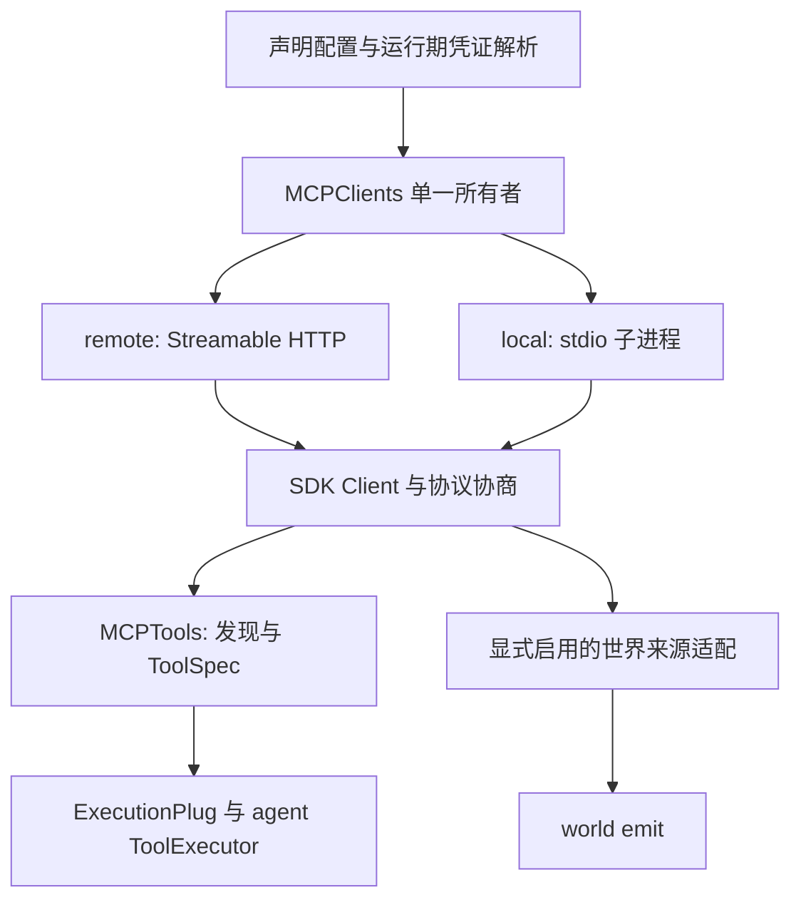

# MCP 通用接入需求与设计草案

状态：B5.1 配置与迁移、B5.2 HTTP 协商、B5.3 stdio 已实现，B5.4 仍为设计。日期：2026-11-03。基线：M4.B1/B2/B4 已交付，M4.B3 扩展共享关闭验收待完成。

本文确定 Aurora 自身支持 HTTP 与 stdio 的方向，不要求第三方 MCP 服务更改传输。v2 配置、迁移入口、HTTP 协商和 stdio 已实现；自动工具命名及产品装配仍为拟议设计。remote/local 均支持 legacy/auto/固定新版，工具桥须显式 include 和 aliases；local 由宿主通过 MCPClients 的 workspace_root 明确提供工作区根目录。既有能力以[启动指南](../examples/START.md#mcp-工具桥)和当前代码为准。

## 1. 目标与范围

用户应当能够像使用 OpenCode 一样，通过声明服务名称、连接方式和凭证引用接入 MCP，无需为每个服务编写 Python 装配代码，也无需逐个重复登记服务端工具。

首轮交付范围：

- 同一宿主同时使用远程 Streamable HTTP 服务和本地 stdio 子进程。
- 传输选择与协议协商相互独立，两种传输共用工具发现、ToolSpec、ExecutionPlug、结果转换及 agent 执行机制。
- 提供按服务名组织的 TOML 配置、运行期环境变量引用和清晰的连接诊断。
- 显式启用 MCP 产品装配后，自动发现并接入所选服务的工具；保留工具过滤和名称覆盖能力。
- 覆盖启动失败、超时、取消、断线、EOF、进程回收、共享客户端关闭和独立安装验收。
- 旧配置有明确迁移路径，不静默改变工具暴露范围、协议策略、公共 ID 或业务快照。

本轮不承诺 OAuth 登录、旧式 HTTP+SSE 传输、任意 SDK 扩展、工具集合热更新、后台自动重连、未完成动作重放、跨进程共享 stdio 服务或完整业务事件投递。`remote` 首轮专指 Streamable HTTP，不等于支持所有网络 MCP 传输。

业务事件单列设计：工具连接成功不代表能够接收 QQ 消息；消息进入 world 也不代表已经提交给 agent 或完成回复。

## 2. 当前能力与差距

| 维度 | 当前实现 | 本设计目标 |
| --- | --- | --- |
| 传输 | MCPClients 支持 Streamable HTTP 与有界 stdio | remote/local 共用客户端所有者；local 使用 stdio |
| 协议 | B5.2 已支持 HTTP legacy/auto/固定新版；实际版本与有界尝试摘要可观察 | legacy、auto、固定新版三种策略，记录实际协商版本 |
| 配置 | B5.1 已提供 v2 servers、headers/environment 引用、显式迁移及服务内工具过滤 | servers 映射、headers/environment 引用、服务内工具过滤 |
| 工具 | 已有稳定别名、分页发现、原子登记、单次调用 | 复用 B2，增加自动名称和默认产品接线 |
| 产品入口 | 用户须手工组合 MCPClients、MCPTools、DefaultAssembly | 选定可选装配入口后只维护服务配置 |
| 世界来源 | 精确资源 URI、资源更新通知及单事件正文 | 保留原边界，扩展通知或事件日志另行接入 |
| 关闭 | 已有连接借用、停止接纳和依赖顺序 | 增加子进程与后代回收，扩展 B3 矩阵 |

相关代码：[客户端](../packages/aurora_adapters/src/aurora_adapters/mcp/clients.py)、[配置](../packages/aurora_adapters/src/aurora_adapters/mcp/configuration.py)、[工具桥](../packages/aurora_adapters/src/aurora_adapters/mcp/tools.py)、[资源通知桥](../packages/aurora_adapters/src/aurora_adapters/mcp/world.py)。

已核对的接入样本：

| 样本 | 传输与协议证据 | 事件形态 | 验收定位 |
| --- | --- | --- | --- |
| ncd | 本机 HTTP；本次检查中 initialize 协商到 2025-11-25，server/discover 返回 -32603；发现 30 个工具，未执行工具 | subscribe_events/read_events 工具及游标读取 | HTTP 旧握手、基础工具兼容；不据一次 -32603 推断服务支持的全部版本 |
| Aurora-QQ | 相邻仓库入口只有 stdio；锁文件为 MCP SDK 2.0.0，测试断言 2026-07-28；尚未通过 Aurora 的 stdio 路径验收 | 自定义 org.aurorabot/world-events 通知扩展 | stdio 新版握手、基础工具；事件扩展另验收 |

QQ 同时声明 org.aurorabot/tool-contract 扩展，涉及业务范围和动作结果未知。普通工具发现/调用兼容不等于完整支持这些扩展。样本观察不作为 CI 对本机端口、账户或相邻仓库的依赖；不在本文保存真实凭证。

## 3. 产品需求与完成标准

| 编号 | 用户需求 | 可验收结果 |
| --- | --- | --- |
| R1 | 添加一个 HTTP 服务 | 配置 URL、可选 headers 和协议即可连接；无需专用服务代码 |
| R2 | 添加一个本地服务 | 配置 command、可选 cwd/environment 即可启动；Windows 含空格路径可用 |
| R3 | 同时使用多个服务 | 两种传输可并存，身份、凭证、状态及工具名称互不混淆 |
| R4 | 不重复填写工具目录 | 选定产品装配后发现的工具自动可用，可按服务过滤；无需再复制到 bot 工具列表 |
| R5 | 知道连接为何失败 | 区分配置、缺凭证、进程启动、握手、能力、目录、执行和关闭错误 |
| R6 | 可靠地结束本次运行 | 取消等待清理，宿主退出后无自有任务、进程、后代或管道残留 |
| R7 | 保留现有数据与配置意图 | 显式迁移后，原工具 ID/名称和来源身份可保持，原文件不自动覆盖 |
| R8 | 知道支持到哪一层 | 分别报告协议/工具能力、已启用扩展和世界来源状态，不将未接入事件标成可用 |

R1–R8 是通用接入的验收条件；不以“两个 SDK 示例能连通”代替产品入口和安装验收。

## 4. 配置设计

### 4.1 文件与最小示例

继续使用 `<data-dir>/config/org.aurora.adapters/config.toml`，由 aurora_config 声明和校验。文件已经代表 MCP 配置，因此不额外嵌套 `[mcp]`。采用 `schema_version = 2` 区分现有 connections/tools 布局，默认模板只提供空 servers 表。

以下 v2 格式已经支持声明校验；示例的 HTTP legacy 已支持，local 运行路径待 B5.3。两个服务均显式选择协议；环境引用只在创建运行资源时展开：

```toml
schema_version = 2

[servers.ncd]
type = "remote"
url = "http://127.0.0.1:54666/mcp"
protocol = "legacy"
oauth = false

[servers.ncd.headers]
Authorization = "Bearer {env:NCD_TOKEN}"

[servers."aurora-qq"]
type = "local"
command = ["uv", "run", "--frozen", "aurora-qq-mcp"]
cwd = 'E:\Aurora\Aurora-QQ'
protocol = "2026-07-28"

[servers."aurora-qq".environment]
AURORA_QQ_TOKEN = "{env:AURORA_QQ_TOKEN}"
```

服务名就是连接身份，沿用现有 connection_id 字符范围和 128 字符上限，区分大小写，不参与 shell 拼接。带点或连字符时推荐使用 TOML 引号键；禁止通过大小写转换合并服务。配置中出现一个服务且 enabled 未设为 false，表示显式选择使用该服务；安装包或发现插件不会据此自动启用宿主插件。

### 4.2 字段与默认值

| 字段 | 适用范围 | 约束与默认值 |
| --- | --- | --- |
| schema_version | 根 | 必须为 2；旧布局按迁移规则处理 |
| servers | 根 | 服务名到声明的映射，默认空 |
| type | 每服务 | 必填 local 或 remote；不同分支的字段不可混用 |
| enabled | 每服务 | 默认 true；false 不解析凭证、不启动进程、不连接或登记工具 |
| protocol | 每服务 | 默认 legacy；可选 auto、2026-07-28 |
| required_capabilities | 每服务 | 默认空；声明必须存在的协议能力，未知项拒绝 |
| timeout | 根及每服务 | startup=10、catalog=30、execution=30、shutdown=10；单位秒，服务字段覆盖根默认 |
| url | remote | 必填 HTTP(S) 地址；保持禁止 userinfo、query、fragment 的现有规则 |
| headers | remote | 默认空；字符串值支持运行期环境引用；大小写等价的重复头拒绝 |
| oauth | remote | 首轮省略或 false；true/对象明确报 unsupported_auth，不伪装支持 |
| command | local | 非空字符串数组；首项为可执行文件，其余为独立参数，不经过 shell |
| cwd | local | 默认宿主明确提供的工作区根目录；相对路径相对于该根目录；须存在且为目录 |
| environment | local | 默认空；显式环境项覆盖 SDK 的基础继承环境，不改变宿主进程环境 |
| tools | 每服务 | 过滤与别名，见第 7 节；不影响单独启用客户端时的无发现行为 |

timeout 各值必须为有限正数；startup/shutdown 上限 300 秒，catalog 上限 3600 秒，execution 上限 43200 秒。startup 覆盖进程创建、传输建立和全部协商步骤；catalog 覆盖一次完整目录分页；execution 约束单次工具调用；shutdown 约束所有者关闭尝试。外层 agent 的工具超时仍有效，实际执行取较早到期的边界。SDK 清理尚未完成时，宿主不得因关闭等待超时而报告成功。

local 不接受 headers/url/oauth，remote 不接受 command/cwd/environment。command、cwd、URL 和服务名不展开环境占位符，避免凭证进入命令行或地址。需要含查询串的服务作为后续需求单独评估，不借通用化顺便放宽现有 URL 规则。

### 4.3 运行期凭证

- 支持 `{env:NAME}` 和头部固定前缀，例如 `Bearer {env:NCD_TOKEN}`；名称按环境变量语法校验，不执行 shell、命令替换或表达式。
- aurora_config 和 ctx 只持有原始声明与引用。解析后的 headers/environment 仅存在于连接所有者的运行期对象中，不写回 TOML、ctx、快照、异常文本或状态。
- 缺失变量或空凭证在启动目标服务前失败，并报告服务名和字段位置，不输出值。已禁用服务不要求其凭证存在。
- 非敏感环境项允许字面量；凭证必须使用引用。Authorization 等明确凭证字段拒绝纯字面量；不得声称能够自动识别所有自定义环境键中的秘密。
- 禁止 CR/LF/NUL 等非法头值，协议控制头由 SDK 管理，不允许配置覆盖。HTTP 保持不自动跨地址跳转、不隐式读取代理环境的当前行为。
- stdio 默认只继承 SDK 的基础环境集合。需要其他变量时显式声明；不把整个宿主 os.environ 注入所有子进程。
- SDK 的 errlog 不能直接指向持久日志。默认丢弃子进程原始 stderr；需要诊断时采用有界、明确启用的脱敏输出。任何原始业务结果都不应被误当作可信日志或配置。

JSON 导入、OpenCode 配置导入和图形化编辑不是首轮要求。后续若增加导入，必须把密钥转换为引用并输出待审核文件，不能把另一份配置中的字面量凭证直接复制进 ctx。

## 5. 统一客户端架构



保留 MCPClients 的单事件循环、借用计数和后台所有者任务。每个服务只有一个所有者任务，由它进入并退出 SDK 上下文；借用方不得自行关闭共享客户端。两种传输只在创建资源、注入运行期参数和回收时分支，业务调用不按 transport 分叉。

B5.2–B5.3 已按实际职责拆分：configuration.py 负责声明；credentials.py 负责引用校验与运行期展开；clients.py 只负责连接所有权与生命周期；transports.py 汇合两种传输并约束 HTTP 错误/重定向；stdio.py 负责工作区路径、进程树及有界管道；negotiation.py 负责协商后校验和有界尝试摘要；errors.py 统一安全错误码；tools.py/world.py 继续作为消费者。迁移器复用 URL 与名称约束，不复制运行期配置解析。私有配置对象可以使用带 type 的联合类型，不引入传输插件注册中心、第二套 JSON-RPC 编解码或泛化 harness。

stdio 复用官方 SDK 的 StdioServerParameters、基础环境、消息校验器及公开平台进程工具，会话和协商继续使用同一个 Client。锁定 SDK 的 stdio_client 没有单帧上限，且 POSIX 正常退出不回收残留后代，因此 stdio.py 只补充有界分帧、进程观察与回收，不调用私有函数或复制协议编解码/会话。每帧上限为 4 MiB（UTF-8 字节，不含换行），接收使用零容量通道施加背压，原始 stderr 直接丢弃；无未结束消息无限缓存。关闭先关 stdin、最多等待 2 秒，再终止所属 Windows Job/POSIX 进程组及回收管道；进程回收任务受独立保护，startup 取消不打断收尾，shutdown 超时后仍可再次等待。回收范围是继承所属 Job/进程组的后代，不扫描进程名或根据持久 PID 杀进程。[SDK stdio 接口](https://py.sdk.modelcontextprotocol.io/api/mcp/client/stdio/)

SDK 类型只在 adapters 内使用。agent 继续接收 ToolSpec、ExecutionPlug 和 JSON 观察，world 继续接收来源消息；core 不增加 MCP、子进程或鉴权语义。

## 6. 协议策略与能力检查

| 策略 | 启动行为 | 成功条件 |
| --- | --- | --- |
| legacy（新配置默认） | 使用 initialize，不先发新版 discover | 协商到明确支持并已验收的旧版本，所需能力满足 |
| auto | 使用 SDK 公共 auto 协商入口；在一个 startup 预算内探测并按 SDK 策略尝试旧握手 | 最终版本在允许集合内，能力满足，记录实际选择 |
| 2026-07-28 | 保持当前显式 send_discover、校验、adopt 路径；不回退 | 服务明确支持该版本及所需能力 |

初始验收集合为 2025-11-25 和 2026-07-28。legacy 是握手策略名，不表示支持所有历史版本；SDK 若协商到更早版本，先明确拒绝，补齐版本验收后再扩展集合。需要精确固定旧版本的配置字段暂不增加。

OpenCode 2.2.5 的 protocol 默认 legacy，并将传输和协商分开声明；本设计借鉴这一配置模型，不承诺全部复刻其功能。[OpenCode 固定版本 schema](https://github.com/anomalyco/opencode/blob/v2.2.5/packages/schema/src/mcp.ts)

auto 的错误边界必须按实际 SDK 行为记录。当前 Python SDK 2.3.0 的 auto 会在多种 RPC 错误（包括 -32603）后尝试 initialize，不能把它描述为仅在 method-not-found 时回退。回退是一种连接探测，只有最后握手成功才构成版本证据；失败保留固定诊断，不宣称服务不支持某版本。传输失败、取消、鉴权失败不得被隐藏为连接成功；对 SDK 的具体回退序列、次数和预算建立回归测试，不调用其私有协商函数或额外叠加重试循环。

B5.2 通过 SDK 公共 `Client(mode=...)` 入口协商，不调用私有探测函数。HTTP 401/403、5xx、重定向及损坏 JSON 在 HTTP 边界明确失败，不让 SDK 转为成功回退；404 及合法 RPC 错误仍沿 SDK 策略尝试旧握手。SDK 的一次版本纠正重探测也在同一个 startup 预算内，测试覆盖实际请求序列。网络故障和取消不续发。固定新版保持显式 discover、确认能力、adopt；不将 SDK 的无探测版本 pin 当作已确认能力。[SDK 协议策略说明](https://py.sdk.modelcontextprotocol.io/protocol-versions/)。

仅在连接建立阶段允许协议探测。任何 tools/call 发出后，都不能通过换版本、换传输、重启子进程、重连或 SDK 多轮便捷接口自动重发。B2 的单次 session 调用、结果未知和取消语义保持不变。HTTP 边界也拒绝携带 Last-Event-ID 的恢复 GET 及第二次后台 GET，阻止 SDK 默认的 SSE 恢复/自动重连发出网络请求；SDK 自身的有限退避等待仍由宿主关闭收束。

能力分三层检查：协议声明是否存在、当前适配器是否实现、消费者是否显式启用。resources 存在不等于资源订阅可用；服务声明 extensions 也不表示客户端已经协商并消费它。首轮保留 B4 对新版订阅的要求，旧版资源订阅不支持时在来源准备阶段明确失败，不能影响同一客户端已支持的工具能力。

## 7. 工具发现、过滤与名称

### 7.1 默认行为

启用 mcp-tools 后，对已启用且声明 tools 能力的服务分页发现工具。默认 include=["*"]、exclude=[]；仅客户端或仅 world 宿主不因此发现工具。没有 tools 能力的服务可供其他消费者使用；产品装配明确要求其工具时须报能力错误。

服务配置可增加以下表；这是第 4 节示例的可选补充，生产配置须按实际所需能力选择工具：

```toml
[servers.ncd.tools]
include = ["list_targets", "server_status"]
exclude = []

[servers.ncd.tools.aliases]
list_targets = "ncd_list_targets"
server_status = "ncd_server_status"

[servers."aurora-qq".tools]
include = ["qq_get_status"]
```

首轮 include/exclude 只允许精确远端名称，以及 include 中独占的通配项 `*`；空 include 表示不暴露工具，exclude 优先。显式名称不存在、alias 指向未选工具、重复远端名称或参数 schema 不满足 ToolSpec 时失败，不静默遗漏。未来如支持按工具跳过无效 schema，应另定义可观察的降级策略。

目录是一次准备阶段的快照：完成分页、超时/重复游标检查、选择和全部冲突检查后原子登记。tools/list_changed 只标记待重新装配，不在运行中的模型工具集合内动态增删。

### 7.2 自动名称与公共身份

显式 aliases 沿用 B2 的名称约束：小写字母开头，字母/数字/单下划线分组，最多 64 字符。未设置 alias 时生成稳定名称，避免要求用户为几十个工具逐个命名。

拟定算法：`mcp_<server_slug>_<tool_slug>_<digest>`。slug 将 ASCII 大写转小写、连续非字母数字字符合并为下划线、去除首尾下划线，空值用 x；分别截取到 16/24 字符并再次去除末尾下划线。digest 使用原始 `[server_name, remote_name]` 的紧凑 UTF-8 JSON（不转义非 ASCII）计算 SHA-256，取前 12 个十六进制字符。名称最长 58 字符，算法以 v2 固定，不受目录顺序或进程重启影响。

哈希不被当成绝对无碰撞保证；自动名称、显式别名、本地工具和已登记 ID 统一检查冲突，发现即失败，不加序号临时避让。工具公共 ID 继续使用 `org.aurora.adapters:tools/mcp/<name>`。实例身份由 bot 分配，与服务名、远端工具名、调用 ID 和 execution_id 分开。

重命名服务会改变自动名称。迁移时保留原服务身份并配置原别名即可保留 B2 工具 ID；不自动改写旧对话里的工具名称或业务快照。

### 7.3 执行契约

所有工具仍通过 ToolExecutor 的参数校验、before_call/after_call 和执行插槽。保留 MCP 内容块及 structuredContent，不自动下载附件、不把资源链接当成指令执行。业务错误保留内容；协议错误和原始传输异常分别转成安全诊断；明确区分尚未提交、已知失败和动作结果未知。

握手兼容不自动启用 sampling、roots、elicitation 或 QQ 私有扩展。额外交互继续明确拒绝；tool-contract 的 unknown 元数据与业务范围，须在后续明确协商并完成映射后才能宣称支持。

## 8. 产品装配与包边界

通用接入不能停留在库接口。拟提供可选 `aurora_adapters.mcp.bot` 插件和 `aurora-adapters[mcp-bot]` extra，集中复用 MCPClients、MCPTools 和 DefaultAssembly；这些名称尚未登记。该插件显式 requires 既有 MCP 工具插件与 bot 默认装配，消费者仍须显式启用完整插件集合，不由 requires 偷偷加载依赖。

拟议宿主装配 ID 为 `org.aurora.adapters:assemblies/mcp/default_bot`。后续在现有 CLI/API 共用宿主路径中选择该装配，并提供一次性初始化预设，避免用户手写 Python。预设只生成缺失配置，已有 host.toml 需先展示差异；不改变普通 DefaultAssembly 的默认依赖和行为。

组合装配创建一个 MCPClients，prepare 先完成连接与目录，再进入模型和工具检查。DefaultAssembly 接收组合装配提供的工具选择增量，并与 bot 原有本地工具选择合并；不把运行期生成目录伪装成 TOML 配置或写回文件。不得通过修改私有 _specs、复制 prepare_bot 或绕过工具工厂来装配。重复工具/实例身份必须显式失败。

基础 adapters 继续仅依赖 core；mcp 提供客户端与两种传输；mcp-tools 可依赖 agent；mcp-world 可依赖 world；只有可选 mcp-bot 依赖 bot。agent/world/bot 均不反向依赖 adapters。更改公共注入接口时同步消费者和测试，拟议新 ID/插件仅在落地时加入公共 ID 目录。

世界来源若一起启用，组合装配复用同一个 MCPClients，并替换 DefaultAssembly 已有的来源装配注入点，保证每个 ctx 只有一个来源所有者；不并排启动通用 configured_sources_component 与 MCP 专用来源所有者。该路径纳入 B3；工具独立宿主始终无需 world。

启用配置中的服务属于明确使用意图；单独查询插件定义、配置 schema 或公共 ID 不得启动命令、解析凭证或访问网络。首轮已启用服务启动/发现失败使对应组合装配失败，沿生命周期清理已启动资源；暂不引入“可选服务失败后静默忽略”的策略。用户可通过 enabled=false 显式排除服务。

## 9. 生命周期与诊断

启动顺序：恢复业务状态 → 加载/校验声明 → 解析所需凭证 → 创建传输 → 协商及能力检查 → 发现并登记工具 → 创建消费者 → 开放输入。每个服务有独立状态，ready 表示该服务的当前准备成功，不代表永久健康或事件可用。

关闭顺序：停止接纳新工作和借用 → 停止世界来源与 agent 自有任务 → 等待/取消剩余请求并收束 finally → 清理工具实例 → 关闭 SDK 会话及传输 → 回收自有子进程 → 宿主最终落盘。

- remote 只关闭本地客户端连接，不结束外部服务进程。
- local 只回收本所有者启动的进程及其后代；先关闭 stdin、限时等待，再使用平台支持的进程树终止。Windows 验证 Job/进程树行为与隐藏启动，禁止通过映像名或未经校验的 PID 批量结束进程。
- stdout 专用于 JSON-RPC；EOF、破损 JSON、超限未结束消息和 BrokenPipe 均可诊断。stderr 必须持续消费或丢弃，不能因管道填满而阻塞服务。
- 停止一个世界来源或关闭一个工具实例不得关闭其他消费者仍借用的连接。等待者取消不重复取消正在收尾的 SDK 所有者任务；关闭失败保留可再次等待的状态，不伪报已完成。
- 本地进程崩溃不自动重启；远程断线不自动重放。未来重连必须重新发现、检查目录变化并处理待定调用，不以恢复状态推断动作已完成。
- stdio 实例默认属于单一宿主；第二个宿主会启动第二个进程。共享服务、多消费者广播和唯一回复所有权须单独设计，不能由传输类型推导。

继续使用非持久 CLIENT_STATUS 及 `{owner, connection_id}` 定位，v2 的 servers 键直接作为 connection_id。B5.2 已新增 type、configured_protocol、negotiated_protocol、negotiation_attempts，阶段复用 phase，不增加同义 stage。旧 protocol_version 字段被 negotiated_protocol 替代，无兼容别名；状态不持久，无业务快照迁移。尝试摘要最多四条，只存方法、HTTP 状态和数值 RPC 错误码；能力拒绝时仍可观察已经确认的版本，accepting 为 false。进程对象与 PID 仅由运行期传输持有，不写入状态或作为恢复后的所有权证据。

诊断至少区分 configuration_invalid、credential_unavailable、process_start_failed、process_exited、startup_timeout、unsupported_protocol、missing_capability、catalog_failed、request_timeout、result_unknown 和 close_failed；名称在实现时与既有代码表统一，不另建平行错误体系。状态不包含 headers/env 实值、原始 stderr、URL 查询参数或 SDK 对象。

## 10. 事件边界

当前资源桥读取某个 URI 的最新内容，event 模式只接收单个 `{message_id, payload}`。稳定身份用于去重，不提供队列或漏读补偿；不能把一串 QQ 消息反复覆盖到同一资源正文后宣称完整交付。

| 需求 | 接入方向 | 保证边界 |
| --- | --- | --- |
| 观察当前状态、允许合并中间更新 | 现有资源通知桥 | 资源变化提示及当前值，不保证逐条历史 |
| 消费 QQ 当前已有业务通知 | adapters 内的 world-events ClientExtension 与来源适配 | 明确 best-effort；断线期间不承诺补发 |
| 连续消息不漏、断线后补读 | 上游事件日志、稳定事件 ID、每消费者独立游标 | 需定义保留窗口、缺口、重复、顺序及持久化提交边界 |

world-events 的 event_id 映射为来源消息身份，在适配层完成；不要求 core/world 理解 SDK 类型或修改通用 world 契约。与源身份组合后，重复载荷返回原记录，异文冲突报错；去重保证仍受 world 保留窗口约束。

可靠事件日志可结合通知唤醒和游标补读，不能用“读取即共享出队”服务多个消费者。只有事件已按承诺持久化后才能推进持久游标，不能把 emit 内存接纳直接当作磁盘提交。回复副作用的幂等和唯一调度所有者另外定义，不承诺 exactly-once。

QQ 当前单 notifier 绑定和 ncd 的游标工具分别需要针对性适配；支持 stdio/HTTP 或多客户端连接本身不解决这些语义。事件扩展不作为首轮工具通用接入的完成条件，cadence 和自动回复仍沿独立里程碑推进。

## 11. 旧配置与身份迁移

新读取器只接受一种规范布局；遇到旧版 connections/tools 或混合布局时提示显式迁移，不长期保留双解析、兼容别名或隐式转发。迁移先生成独立候选文件和差异，用户应用前不覆盖原 TOML、不连接服务、不解析凭证。

| 旧项 | v2 对应 | 保留要求 |
| --- | --- | --- |
| connections[].connection_id | servers 的键 | 原字符串不变；world 的 connection_id 引用无需改名 |
| url | type=remote 与 url | 地址不自动改写 |
| token_env | headers.Authorization 中的环境引用 | 不读取或复制实际 token |
| 固定新版行为 | 显式 protocol=2026-07-28 | 不因新默认 legacy 而改变既有连接策略 |
| connect_timeout | timeout.startup | 单位仍为秒 |
| request_timeout | timeout.catalog 与 timeout.execution | 迁移同时核对宿主/agent 外层超时 |
| tools[] | 对应服务 tools.include 与 aliases | 保留原本地名称和 ID；无旧选项的服务迁移为 include=[]，不意外暴露全部工具 |
| bot 显式 MCP 工具选择 | 新组合装配的自动选择或保留显式选择 | 迁移须列出并消除重复装配，保留既有实例身份或显式报告变化 |

现有配置、客户端状态及工具配置不进入持久业务快照，但对话中的工具名称、world 的来源身份和消费位置可能已持久化。公共 ID/实例身份变化必须展示影响，不静默删除历史状态或跳过未登记状态。模板仍只补缺失文件，不能通过“更新模板”替用户迁移。

旧配置若将同一服务的同一个远端工具映射成多个本地别名，v2 的单别名映射无法原样表达，迁移器须列出冲突并停止自动转换，不能只保留其中一个。多 bot 实例或多个不同配置的旧工具实例也须检查实际消费者，不能假定都能合并成一次自动选择。

MCP 配置、客户端/工具组件和资源来源的现有公共定义原则上保持；仅新增确有消费者的产品装配定义。实现时同步公共 ID 目录、安装 extra、entry points、配置编辑器、示例、生成契约及全部消费者，是否需要重新生成以实际契约差异为准。

## 12. 任务切片

以 M4.B5 表示通用接入，保留 B1/B2/B4 已交付编号；B3 扩展到两种传输的共享关闭验收。

| 切片 | 交付 | 验收重点 |
| --- | --- | --- |
| B5.1 配置与迁移（已交付） | v2 schema、模板、运行期引用、显式迁移候选输出 | 不启动资源、无凭证落盘、暴露范围与旧 ID 保持 |
| B5.2 HTTP 协议协商（已交付） | legacy/auto/固定新版、版本和能力诊断 | 旧/新测试服务、RPC/HTTP 错误分类、协商预算、单次工具调用 |
| B5.3 stdio（已交付） | SDK 会话接入有界管道、同一所有者、环境和工作区路径 | Windows/Linux 真子进程、EOF/取消、后代与管道回收 |
| B5.4 工具与产品接线 | 自动名称/过滤、可选组合装配及初始化预设 | CLI/API 无自编 Python 接线、无重复登记、不自动启用依赖 |
| B3 扩展验收 | 世界来源和工具共用客户端、跨传输关闭矩阵 | 资源独立、停止接纳、收尾、最后落盘、独立安装 |
| 事件后续切片 | world-events 或事件日志的明确契约 | 另按交付保证排期，不以工具验收替代 |

B5.1 迁移入口为 `python -m aurora_adapters.mcp.migrate <旧文件> --output <新候选>`，打印忽略注释和排版的规范化差异；不覆盖已有文件或读取凭证。保留 bot 显式工具选择、各实例身份和 world 引用，不合并消费者。新读取器不接受旧布局。local 在 prepare 解析目录和环境后启动；工具桥不支持默认通配及缺少别名的自动命名，明确报 unsupported_tool_selection。迁移及运行示例见[启动指南](../examples/START.md#mcp-独立客户端验收)。

B5.1 的 startup/catalog/execution 分别提供操作预算；SDK 请求与 HTTP 空闲读取上限取三者最大值，避免执行超时提前截断目录或握手。shutdown 限制每服务每次 stop/clean 等待，超时保留清理任务供再次等待；迁移显式写出默认 10 秒。

不以预估代码行数决定方案；以资源所有权、错误语义、用户配置步骤和上述验收作为完成依据。实现阶段若调整默认协议、失败策略或命名算法，应先更新本文和迁移方案。

## 13. 验收矩阵

| 范围 | 必须覆盖的场景 |
| --- | --- |
| 配置 | local/remote 正反例、禁用项无副作用、类型混用、缺环境引用、非法头值、相对 cwd、空命令、Windows 引号和空格 |
| 协议 | HTTP/stdio × legacy/auto/固定新版；新版仅支持服务与旧版仅支持服务；-32601/-32603、401/403、错误版本、畸形响应、超时与取消 |
| 工具 | 无配置别名自动发现、多服务同名/Unicode/截断碰撞、显式过滤、别名冲突、分页原子性、目录变化、标准内容块与结构化结果 |
| 执行 | before_call/after_call、参数拒绝、业务/协议失败、发送后断线与进程退出、外层超时、取消、未执行后续调用、零自动重发 |
| 进程 | 命令缺失、启动即退出、握手卡住、stdout 污染、stderr 洪泛、子孙进程、宿主启动失败、关闭等待取消/重试、无孤儿或可见窗口 |
| 共享 | 两个工具及工具/来源共用一连接；停止来源不误关工具；一个本地服务故障不直接关闭另一个服务；全局退出清理全部自有资源 |
| 状态 | 协商版本准确、固定错误码、配置引用可观察但解析凭证不可见；停止后快照无客户端/进程对象 |
| 产品 | 正式 CLI/API 配置路径、缺失文件初始化、用户文件不覆盖、禁用服务、准备顺序、bot 原有工具保持、失败清理 |
| 迁移 | 旧版无工具与有工具配置、旧别名/ID、world 来源身份、已有 bot 实例身份、旧文件保持与混合布局拒绝 |
| 分发 | 基础 adapters/control 无 agent/模型；mcp 无 world/bot；mcp-tools 无 world/bot；mcp-world 无 agent/bot；mcp-bot 显式安装；wheel 包含模板 |

普通回归使用假模型、模拟 HTTP 与本机测试进程，不调用真实供应商。实现阶段运行针对性回归、完整检查与 wheel 安装验收；保留现有五条产品示例，专项验收放 tests/fixtures。

真实兼容性单独记录：先对 ncd/Aurora-QQ 做握手和目录验证，再执行明确选定的只读状态工具。发消息、订阅业务事件和其他副作用不由“接入成功”隐含授权。记录 SDK/服务版本、传输、协商版本、能力及未验收边界，不记录凭证。

## 14. 参考与设计取舍

- [OpenCode 2.2.5 配置定义](https://github.com/anomalyco/opencode/blob/v2.2.5/packages/schema/src/mcp.ts)：按名称组织 local/remote，protocol 独立于传输；本设计采用 TOML 和 Aurora 的凭证边界。
- [OpenCode 2.2.5 客户端](https://github.com/anomalyco/opencode/blob/v2.2.5/packages/core/src/mcp/client.ts)：两种传输汇合到统一客户端，再向上提供工具等能力。不同 SDK 的协商和重试策略不应仅凭同名 auto 推断等价。
- [OpenCode 2.2.5 stdio 实现](https://github.com/anomalyco/opencode/blob/v2.2.5/packages/core/src/mcp/stdio.ts)：配置简洁依赖内部进程管理；Aurora 优先复用 Python SDK，不照搬其执行环境框架。
- [OpenCode 配置 schema](https://opencode.ai/config.json)：用于核对用户配置入口；在线 schema 会变化，行为依据以上固定版本代码。
- [Aurora 计划](plan.md#82-m4-b最小-mcp-扩展)、[架构边界](aurorabot-design-v0.2.3.md)、[公共 ID](aurorabot-id-catalog-v0.2.3.md)：本文新增通用接入方向，不将草案条目计为已实现能力。

后续需要单独立项的选择包括 OAuth、含查询串 URL、旧式 SSE、更多历史协议版本、目录热更新与事件可靠交付；这些均不阻塞本轮 HTTP/stdio 与工具装配闭环。
